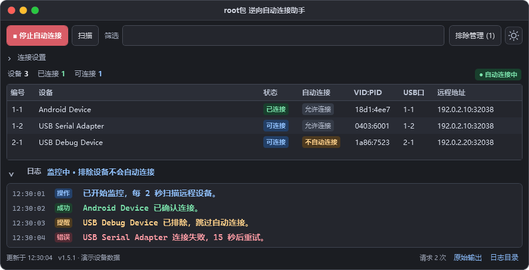
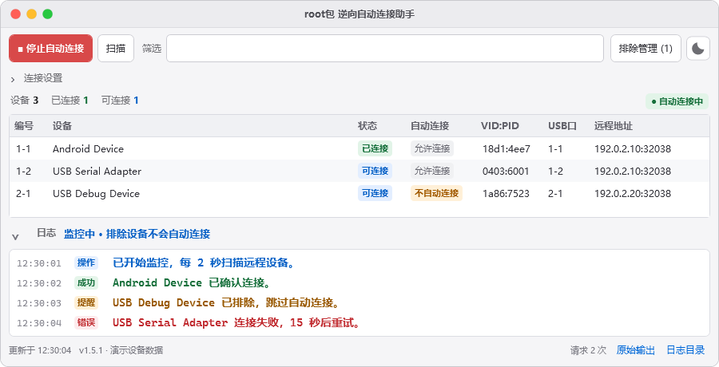
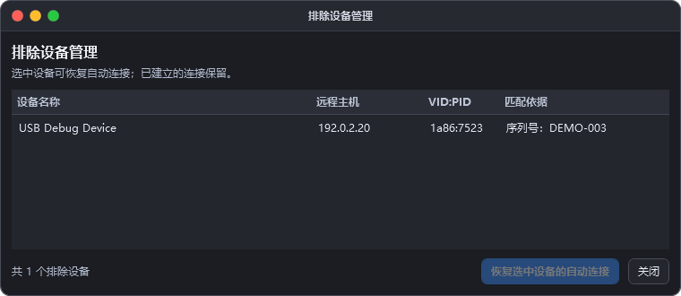

<p align="center">
  
</p>
<h1 align="center">root包 逆向自动连接助手</h1>
<p align="center">USB Redirector Technician Edition 远程设备自动连接工具</p>
<p align="center">Windows · WPF · .NET Framework 4.7.1+ · v1.5.1</p>

把重复点击“连接”的操作交给助手：自动发现技师端里的可用设备，按筛选和排除规则发起连接，并用清晰的状态标签和彩色日志显示结果。

**[下载 v1.5.1 发布包](downloads/root-autoconnect-net471-v1.5.1.zip?raw=true)** · [使用说明](docs/USAGE.md) · [构建与验证](docs/DEVELOPMENT.md)



> 截图由实际 WPF 界面渲染，采用演示设备、示例地址和示例日志，不包含真实客户信息。

## 功能

- **自动连接**：定时扫描，连接当前及后续出现的可用设备；连接前再次核对身份和状态。
- **自动定位技师端**：支持安装记录、运行进程、快捷方式、常见目录及有时间限制的磁盘补充查找，也可手动浏览。
- **筛选与排除**：按名称、VID/PID、序列号、USB 端口或地址筛选；右键排除设备，并在管理窗口中批量恢复。
- **失败重试**：默认每 2 秒扫描、同一设备至少间隔 15 秒重试，避免重复发起请求。
- **明暗主题**：macOS 风格的紧凑界面，太阳／月亮按钮切换，带颜色渐变和图标过渡，并保存选择。
- **高亮日志**：14 号字体，区分操作、成功、提醒与错误；状态以技师端重新扫描结果为准。
- **小体积**：当前 EXE 约 **130 KB**，不捆绑 .NET 10，也不需要额外第三方 DLL。

## 下载与使用

1. [下载发布包](downloads/root-autoconnect-net471-v1.5.1.zip?raw=true)，完整解压。
2. 保持 `root包 逆向自动连接助手.exe` 与同名 `.exe.config` 文件在同一目录，双击 EXE。
3. 客户通过原来的 Customer Module 接入 USB Redirector 技师端。
4. 助手自动定位技师端并读取设备；点击 **开始自动连接** 后生效。
5. 需要跳过某台设备时，右键选择 **不自动连接此设备**。

首次启动只读扫描，默认不自动接管设备。停止或关闭助手后，已建立的连接保留；已发出的连接请求仍可能由技师端完成。

## 运行要求

| 项目 | 要求 |
| --- | --- |
| 操作系统 | Windows；当前在 Windows 11 x64 实测 |
| 运行环境 | .NET Framework 4.7.1 或更高版本，包括 4.8 / 4.8.1 |
| 技师端 | 可正常工作的 USB Redirector Technician Edition，包含 `usbtechsh.exe` |
| 已适配版本 | Technician Edition **1.9.7.3130** 的英文命令行格式 |

其他技师端版本需要兼容相同的命令和列表格式。软件不包含原厂技师端、Customer Module、USB 驱动或许可证。

## 软件截图

### 浅色界面



### 排除设备管理



## 工作方式

助手调用技师端自带的 `usbtechsh.exe` 列出远程设备，并只对符合规则且处于“可连接”状态的设备提交连接请求。它不依赖鼠标坐标、窗口位置或屏幕识别。

设置和本地日志保存在 `%LOCALAPPDATA%\UsbAutoConnect`。截图生成工具使用独立的演示数据，不读取设备、不连接服务，也不修改用户设置。

## 更新记录

### v1.5.1

修复首次启动、缺失或无效技师端路径时的崩溃；窗口先打开，再自动定位。遇到未处理异常时显示提示并写入诊断日志。

### v1.5.0

迁移至 .NET Framework 4.7.1，保留设备连接、排除管理、主题动画和高亮日志，大幅减小分发体积。

## 开发

使用 .NET 10 SDK 编译 C# 源码，并安装 .NET Framework 4.7.1 Targeting Pack。**使用软件本身不需要安装 SDK。**

```powershell
.\tools\Publish.ps1
```

输出位于 `发布/root包 逆向自动连接助手-net471`，下载包位于 `downloads`。详细验证命令和截图生成方法见 [开发说明](docs/DEVELOPMENT.md)。
